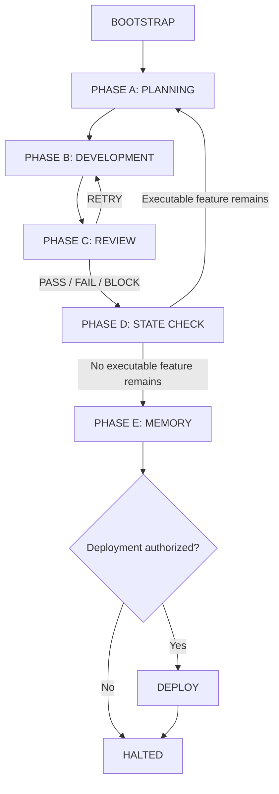

# 🤖 Autonomous Orchestrator Workflow

`autonomous-orchestrator` is the skill-driven sovereign loop. It manages product state and delegates every technical task to specialist agents. It does not write application code or tests itself.

## Invoke

```text
/harness-kit:autonomous-orchestrator
```

## Initial input gate

> [!TIP]
> The autonomous backlog loop is optional for developers. For clear, bounded work, invoke `tdd-orchestrator` directly with project memory. When business and technical refinement are needed, use `pbb-design` first, then `scope-refinement`, as described in the [Daily Use Playbook](PLAYBOOK-DAILY-USE.md#flow-2-business-and-technical-refinement-optional).

When using the `cto` agent for a product idea or underspecified feature, it invokes `pbb-design` before delivery. A validated, traceable backlog may be reused; analysis-only requests do not start delivery. The handoff includes product boundaries, problems, expectations, personas, functionalities, PBIs, validated decisions, provisional assumptions, and deferred questions. PBB is not an automatic phase of a direct `autonomous-orchestrator` invocation.

The skill collects required input at its initial gate and Bootstrap:

1. Choose `resume` or `reset`.
2. For `reset`, provide the project scope or PRD.
3. Provide project paths if they are not known.

After required bootstrap input exists, the orchestrator continues without phase-by-phase questions. It stops when the backlog finishes, a critical blocker prevents progress, or the human interrupts execution.

`reset` discards files under `docs/product/`. Review that scope before confirming reset.

## Delegation map

| Work | Skill | Agent |
| --- | --- | --- |
| Business design before delivery, when routed through CTO | `pbb-design` | `cto` invokes the skill |
| Domain planning | `scope-refinement` | `software-architect` |
| Backend implementation | `tdd-orchestrator` | `developer-backend` |
| Frontend implementation | `tdd-orchestrator` | `developer-frontend` |
| Test-focused implementation | `tdd-orchestrator` | `developer-qa` |
| Infrastructure implementation | `tdd-orchestrator` | `developer-devops` |
| Unexpected test failure diagnosis | investigation workflow | `developer-debugging` |
| Systemic technical review | `the-grumpy-tech-lead` | `harness-tech-lead` |
| Adversarial validation | `adversarial-qa` | `harness-qa` |
| Final project memory | `project-memory` | `software-architect` |

The backlog `Agent` column selects the implementation specialist. `developer-debugging` is diagnostic only.

## State flow



The skill also mentions an optional `REFINEMENT` handler after BOOTSTRAP when enabled and `REFINEMENT.md` is absent. Its current prompt and configuration template do not define the enabling option or handler contract. Do not assume this step invokes PBB or replaces Phase A; supply business refinement explicitly before delivery when needed.

## Phase responsibilities

### BOOTSTRAP

- Create product files from `skills/autonomous-orchestrator/models/` when missing.
- Persist project paths, scope, `currentPhase`, `activeFeatureId`, and cycle count.
- Build cohesive, independently testable features.
- Load `scoreThresholdTL` and `scoreThresholdAdv` (default `0.70`) and `completionCriteria.maxReworks` (default `2`) from `BOOTSTRAP-CONFIG.json`.
- Preserve supplied phase-scoped `steeringRules`. Keep feature scores and rework counts in `BACKLOG.md`; `DEVELOPMENT-STATE.md` tracks task-level progress.

### PHASE A: PLANNING

- Mark the feature `IN_PROGRESS`.
- Delegate `scope-refinement` to `software-architect`.
- Require `004-*-test-scenarios.md`.
- Extract ordered task JSON from `003-*-tactical-design.md` into `DEVELOPMENT-STATE.md`.

This planning contract still applies inside the autonomous loop even though refinement is optional for direct interactive TDD. Invalid task JSON is logged and prevents that feature's planning from advancing.

### PHASE B: DEVELOPMENT

- Mark all pending feature tasks `IN_PROGRESS`.
- Delegate all pending tasks together through `tdd-orchestrator`.
- Require matching `featureId` in `TDD-OUTPUT.json`, `status = "SUCCESS"`, zero failed tests, and `developerHandoff` of at most 500 characters. Missing, corrupt, mismatched, or failed output keeps affected tasks non-complete and prevents review.
- Route unexpected test failures through `developer-debugging` before a fix attempt.

### PHASE C: REVIEW

- Run `the-grumpy-tech-lead` and `adversarial-qa` in parallel.
- Read `TL.json` and `QA.json` scores in the `[0.00, 1.00]` range.
- Compare scores with `scoreThresholdTL` and `scoreThresholdAdv`.
- Treat demonstrated HIGH/CRITICAL vulnerabilities and crashes as gate failures regardless of score.

Every task must be `COMPLETED` before review starts. Pass the developer handoff as navigation context; both reviewers verify it independently. Review reports live under `docs/specs/{domain}/`; if report files are unavailable or corrupt, the skill attempts JSON extraction from reviewer output. That fallback still needs valid evidence for the active feature.

Verdicts:

- `PASS`: thresholds met; no HIGH/CRITICAL vulnerability; no crash. Persist `COMPLETED`.
- `RETRY`: gate failed while rework budget remains. Write `REWORK-LOG.md`, reset tasks, return to development.
- `BLOCK`: budget exhausted with crash or unresolved HIGH/CRITICAL vulnerability. Persist `BLOCKED`.
- `FAIL`: budget exhausted without crash or unresolved HIGH/CRITICAL vulnerability. Persist `FAILED`.

`RETRY`, `PASS`, `BLOCK`, and `FAIL` are gate verdicts. Persisted feature statuses are `NOT_STARTED`, `IN_PROGRESS`, `COMPLETED`, `BLOCKED`, and `FAILED`.

### PHASE D: STATE CHECK

- Validate terminal statuses, scores, and rework counts.
- Cascade `BLOCKED` to dependent features.
- Do not cascade `FAILED`.
- Select the next executable feature or continue to memory.

A blocked feature may leave independent work executable. `HALTED` means the loop stopped, not that every feature succeeded. Report completed, failed, blocked, and remaining work separately. Any inconsistent state or unresolved gate condition must remain explicit.

### PHASE E: MEMORY

- Delegate `project-memory` once after no executable feature remains.
- Document completed features and relevant architecture/test-strategy changes. Assess digest and graph synchronization; preserve equivalent content under the project-memory contract.
- Keep harness history outside this skill's access.

Project memory executes its six-stage workflow, including one bounded Dream-inspired consolidation pass and digest curation. Preserve evidence, IDs, uncertainty, and canonical ownership. Review scores and TDD process history remain in product records rather than feature documentation. Do not create extra ADRs during this phase without the human decision required by the orchestrator.

The orchestrator requires this delegation; missing validation or incomplete memory work must be reported rather than treated as successful synchronization. Runtime acceptance through `qa-orchestrator` is a separate workflow and is not automatically implied by the Phase C scores.

### DEPLOY

Delegate only when current user and repository rules authorize deployment. If staging, commit, push, or deployment is forbidden, record the skip and halt without those actions.

## Recovery and human control

- Interrupt a drifting run with the host's stop mechanism.
- Resume first from a valid persisted `currentPhase` other than `HALTED`, with its `activeFeatureId`. Otherwise apply the skill's ordered re-entry table against current files; do not restart an in-progress feature from planning by default.
- Change scope or architecture only after stopping active writes.
- Keep `BACKLOG.md`, `DEVELOPMENT-STATE.md`, `DECISIONS.md`, and `BOOTSTRAP-CONFIG.json` consistent when editing manually.
- Inspect `DECISIONS.md` before treating a halted loop as successful.

## Required safety properties

- The orchestrator never emulates a developer agent.
- State changes are written before delegated work starts.
- Review evidence must match the active feature and domain.
- Active skills, agent rules, user rules, and repository rules remain binding throughout delegation.
