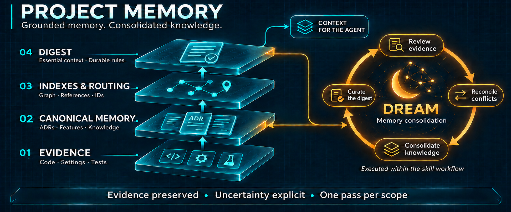

# HarnessKit: Daily Use Playbook

Practical routing guide for project skills and agents. Invoke only the smallest workflow that covers the task.

> [!TIP]
> For clear, bounded changes, go directly to Flow 3 and use existing project memory to guide development. Use Flow 2 for complex scenarios that need domain modeling or consequential scope decisions. The flow numbers organize this guide; they are not mandatory steps for every task.

Commands below use the HarnessKit slash-command syntax. Supply the task context with the invocation. Exact execution rules remain in each skill's `SKILL.md`; agent names identify responsibility rather than additional mandatory invocations.

## Before starting

- Identify project path, domain, desired outcome, acceptance criteria, and constraints.
- Route an explicitly supplied document path directly. Otherwise, use `docs/.digest.md` and `docs/.graph.json` for targeted orientation. Follow required related documents and only relevant optional routes; fall back to scoped file searches when routing is missing or stale.
- Preserve user and repository rules. Skills do not override them.
- Choose an agent whose ownership matches the work.
- Define applicable checks before starting. Require executed evidence for implementation and runtime claims; distinguish documentation checks, inspected source, and unverified behavior.

## Decision guide

| Need | Skill | Primary agent |
| --- | --- | --- |
| Initialize or update durable docs | `project-memory` | `software-architect` |
| Refine complex scope, domain rules, or cross-domain dependencies | `scope-refinement` | `software-architect` |
| Convert a prototype into UI structure | `read-ui-prototype` | specification targets `developer-frontend` |
| Implement backend work | `tdd-orchestrator` | `developer-backend` |
| Implement frontend work | `tdd-orchestrator` | `developer-frontend` |
| Implement test-focused work | `tdd-orchestrator` | `developer-qa` |
| Implement CI/CD or infrastructure work | `tdd-orchestrator` | `developer-devops` |
| Diagnose an unknown failure | investigation workflow | `developer-debugging` |
| Review systemic technical risk | `the-grumpy-tech-lead` | `harness-tech-lead` |
| Probe edge cases and security | `adversarial-qa` | `harness-qa` |
| Validate acceptance behavior against a running application | `qa-orchestrator` | main agent coordinates runtime QA |
| Run the complete backlog loop | `autonomous-orchestrator` | orchestrator delegates specialists |
| Record a run | `harness-tracer` | `meta-harness-agent` |
| Compare harness runs | `harness-evaluator` | `meta-harness-agent` |
| Propose a skill improvement | `meta-harness` | `meta-harness-agent` |

## Flow 1: initialize project memory



```text
/harness-kit:project-memory
```

Use for a new repository, a targeted documentation update, or requested memory consolidation. State the project path, selected documents or domain, desired outcome, allowed writes, and relevant evidence. For example:

```text
Update project memory for <project-path>, limited to <feature/domain>.
Inspect <changed-files> and reconcile the owning documentation.
Preserve unrelated content; report checks and remaining evidence gaps.
```

Choose the review mode explicitly when maintenance extends beyond an ordinary correction:

| Mode | Use when | Scope |
| --- | --- | --- |
| Targeted (default) | A feature, document, or correction changed | Selected questions and affected references |
| Consolidation | Memory needs reconciliation after observed changes or conflicts | Selected knowledge and its canonical owners |
| Full review | A complete audit or regeneration is explicitly requested | Every ADR/feature in the authorized documentation scope |

Providing a directory does not request a full review. A read-only request produces findings without creating baselines or rewriting indexes. When initializing documentation, the expected baseline is:

- `docs/README.md`
- `docs/adr/ARCHITECTURE.md`
- `docs/adr/TESTS.md`
- `docs/.digest.md`
- `docs/.graph.json`

Only `ARCHITECTURE.md` and `TESTS.md` are mandatory ADRs. Additional ADRs require an explicit request or necessary architecture decomposition under the document contract. Incremental consolidation may report unrelated missing baselines without creating them.

Execution follows six stages: select scope, ground knowledge, update canonical documents, consolidate once, curate the digest, then validate and synchronize.

### Dream: consolidate project memory

Dream describes the consolidation and curation inside this workflow. After grounding, compare selected claims, reconcile true duplicates and affected references, retain unresolved conflicts, and promote only grounded knowledge useful across future tasks into the digest. Preserve evidence, IDs, conditions, and the distinction between requirements, observations, and hypotheses.

Request consolidation after source changes invalidate documentation, conflicting claims appear, or an observed recurring mistake warrants a durable reminder. Name the affected domain and next task. Do not request a full repository scan for every edit. The default budget is one grounding pass and one consolidation pass per selected domain; a no-change result is valid.

Dream runs when the skill is invoked. It does not schedule background work or train model parameters. Graphs route to canonical documents; the digest provides compact orientation. Structural validation does not establish factual correctness or improved LLM accuracy.

The skill may write `docs/adr/**`, `docs/feature/**`, `docs/README.md`, `docs/.digest.md`, `docs/.graph.json`, and targeted root `README.md` edits. It must not read or modify `docs/harness-history/` or manage specification/workflow folders.

Expect changed paths, material corrections, digest promotions/demotions, checks actually run, and explicit gaps. Equivalent documents and dates stay unchanged; synchronize indexes only when affected. Report partial evidence coverage separately from blocked validation.

## Flow 2: refine scope

```text
/harness-kit:scope-refinement
```

Recommended for complex scenarios: new or unclear domain boundaries, interacting business rules, cross-project dependencies, or architectural decisions that existing memory does not resolve. For a clear change within established patterns, proceed directly to Flow 3.

When refinement is needed, provide project paths, domain, scope, business rules, and known constraints.

Interactive mode collects inputs and performs the refinement interview and verification gates. Autonomous mode receives variables from the orchestrator and runs the interview using generated recommendations without human pauses. Inspect consequential assumptions in the resulting specifications before relying on them.

Expected documents:

```text
docs/specs/{domain}/
├── 001-problem-space.md
├── 002-context-map.md
├── 003-*-tactical-design.md
└── 004-*-test-scenarios.md
```

Once invoked, the skill runs its document phases sequentially. Before implementation, confirm that tactical tasks and test scenarios cover the selected outcome and constraints.

## Flow 3: implement with TDD

```text
/harness-kit:tdd-orchestrator
```

For direct interactive use, provide the project path, requirement, acceptance criteria, and constraints. Prior Flow 2 documents are not required for a clear, bounded task: the TDD workflow derives tests from the requirement.

Use project memory to guide architecture, conventions, test commands, and implementation paths: start with `docs/.digest.md`, route through `docs/.graph.json` and the relevant feature micrograph, then consult owning ADRs and source files as needed. Check stale or conflicting guidance against current evidence. Memory guides implementation; the current requirement defines the requested behavior.

Autonomous invocation requires the feature ID, domain, project paths, selected tasks, tactical design, and pre-specified test scenarios. Reuse existing specifications when they cover the task. Resolve material requirement gaps before implementation; use Flow 2 when the complexity warrants it.

Execution contract:

1. RED: derive tests from the requirement in interactive mode, or from pre-specified scenarios in autonomous mode; prove they fail for the expected reason.
2. GREEN: implement the smallest code that passes.
3. REFACTOR: improve structure while keeping tests green.
4. Validate: run required targeted and regression checks.
5. Document: in interactive mode, invoke `project-memory` when project behavior or structure changed.

If tests fail unexpectedly, route diagnosis to `developer-debugging`. That agent proves root cause and hands off; it does not implement the final fix.

Autonomous mode writes `docs/specs/{domain}/TDD-OUTPUT.json`. It does not emit interactive progress blocks.

In the autonomous backlog loop, final project-memory synchronization belongs to the orchestrator's memory phase. Do not interpret a successful TDD output as proof that documentation or runtime acceptance checks are complete.

## Flow 4: review

Technical review:

```text
/harness-kit:the-grumpy-tech-lead
```

Use for concrete systemic risks: security, scalability, concurrency, data consistency, performance, maintainability, and architecture.

Adversarial validation:

```text
/harness-kit:adversarial-qa
```

Use against machine-readable specifications and implemented code. It tests boundaries, error handling, abuse cases, and demonstrated security weaknesses.

Both autonomous reviewers return scores in `[0.00, 1.00]`. Default threshold is `0.70`. HIGH/CRITICAL vulnerabilities fail adversarial validation regardless of score.

Read the configured thresholds from `docs/product/BOOTSTRAP-CONFIG.json` in the autonomous loop. A passing score does not replace required tests or clear unresolved findings by itself.

Review agents report findings. Route fixes back through the responsible developer agent and TDD workflow.

### Runtime acceptance QA

```text
/harness-kit:qa-orchestrator
```

Use when acceptance criteria need execution against a running application's supported interface. Provide the target, scope, acceptance criteria, authentication profile name when needed, and execution restrictions. Use TDD for unit-test work and the technical reviewer for static review.

The skill checks runner readiness, previews commands through its safety wrapper, and requires explicit confirmation before execution. Use the runner matching the controlling environment, such as `codex-cli` for Codex; do not silently switch providers. Keep credential values out of prompts and command arguments.

Use `qa run` for a new execution, `qa report --run <run-id>` to regenerate an existing run's report, and `qa exploratory` to execute saved plans. Let the skill construct and confirm the exact command. Report runtime verdicts with evidence and coverage gaps.

## Flow 5: autonomous backlog

```text
/harness-kit:autonomous-orchestrator
```

Use when scope and project paths are sufficiently complete for uninterrupted delegation.

The orchestrator asks `resume` or `reset` at its initial gate. `resume` preserves `docs/product/`; `reset` discards that product state and collects new scope. Then it owns state transitions and delegates planning, implementation, review, and memory.

Before starting:

- Confirm reset will not discard product state you need.
- Ensure backlog dependencies can be inferred from scope.
- State repository restrictions explicitly.
- Ensure any deployment action is authorized. The orchestrator must skip forbidden staging, commit, push, or deployment actions.

See [AUTONOMOUS-ORCHESTRATOR.md](AUTONOMOUS-ORCHESTRATOR.md).

## Flow 6: optimize the harness

Record a completed session:

```text
/harness-kit:harness-tracer
```

When invoked, `meta-harness-agent` routes to `harness-evaluator` at positive multiples of `5` traces unless an explicit meta-harness request takes priority. Trace count alone does not start a background evaluation.

Manual evaluation:

```text
/harness-kit:harness-evaluator
```

Candidate proposal after at least `3` traces and a current frontier:

```text
/harness-kit:meta-harness
```

Never promote a candidate without explicit human approval. See [META-HARNESS.md](META-HARNESS.md).

## Common mistakes

| Mistake | Correct action |
| --- | --- |
| Running full scope refinement for every small change | Use Flow 3 directly when the requirement is clear and project memory provides sufficient guidance |
| Starting implementation with material requirement gaps | Clarify the missing decisions; use Flow 2 for complex domain or scope questions |
| Treating `developer-debugging` as a fix implementer | Use it for diagnosis; route handoff to developer or architect |
| Inventing tests beyond approved autonomous scenarios | Update scope/specs first, then run TDD |
| Claiming success without test output | Run the applicable test suite and report evidence |
| Asking review agents to implement their findings | Route findings to responsible developer agent |
| Letting `project-memory` touch harness history | Use tracer, evaluator, or meta-harness agent |
| Treating Dream as automatic retraining or a full audit | Request bounded consolidation with named evidence and scope |
| Treating valid graphs or fresh dates as verified knowledge | Inspect evidence and preserve unresolved or stale status |
| Using adversarial review as proof of runtime acceptance | Run `qa-orchestrator` when acceptance behavior needs execution |
| Assuming fifth trace always creates a candidate | Fifth trace routes evaluation; candidate search requires explicit request |
| Applying a candidate immediately | Compare evidence and request human approval |

## Completion checklist

- [ ] Output matches approved scope and acceptance criteria.
- [ ] RED failure reason and subsequent passing checks are recorded for TDD work; refactoring preserves those checks when performed.
- [ ] Applicable regression and runtime acceptance checks pass, or unavailable checks and their impact are explicit.
- [ ] Review findings are resolved or explicitly recorded.
- [ ] Durable project memory reflects changed behavior or architecture.
- [ ] Memory changes preserve grounding and uncertainty; unchanged content was not rewritten solely to refresh dates.
- [ ] Harness trace records facts only when optimization evidence is desired.
