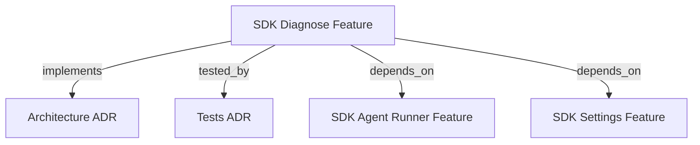

```graph
{"node_id":"feature:sdk_diagnose","domain":"diagnose","implements":["adr:architecture"],"tested_by":["adr:tests"],"depends_on":["feature:sdk_agent_runner","feature:sdk_settings"],"entrypoints":["src/diagnose/DiagnoseService.ts","src/cli/services/candidate-service.ts"],"registration_files":["src/index.ts"],"reference_files":["src/diagnose/JsonlSessionLedger.ts","src/diagnose/SessionIdGenerator.ts"],"code_files":["src/diagnose/CandidatePromotionService.ts","src/diagnose/CandidateReader.ts","src/diagnose/DiagnoseReportRenderer.ts","src/diagnose/MetaHarnessAgentAdapter.ts","src/diagnose/TraceDirectoryScanner.ts","src/diagnose/types.ts","src/diagnose/utils/DiagnosePaths.ts","src/diagnose/SkillBaselineReader.ts"],"test_files":["src/diagnose/__tests__/CandidatePromotionService.test.ts","src/diagnose/__tests__/CandidateReader.test.ts","src/diagnose/__tests__/DiagnoseReportRenderer.test.ts","src/diagnose/__tests__/DiagnoseService.test.ts","src/diagnose/__tests__/JsonlSessionLedger.test.ts","src/diagnose/__tests__/MetaHarnessAgentAdapter.test.ts","src/diagnose/__tests__/SessionIdGenerator.test.ts","src/diagnose/__tests__/TraceDirectoryScanner.test.ts","src/diagnose/__tests__/types.test.ts","src/diagnose/utils/__tests__/DiagnosePaths.test.ts","src/cli/services/__tests__/diagnose-service.test.ts","src/cli/services/__tests__/candidate-service.test.ts"],"knowledge":{"schema_version":1,"entities":[{"id":"capability:diagnosis-session-processing","type":"capability","label":"Diagnosis session processing","definition":"Process pending diagnosis sessions and produce diagnosis outputs through the configured agent runner.","aliases":[]}],"claims":[{"id":"claim:diagnose-phase-settings","subject":"capability:diagnosis-session-processing","relation":null,"object":null,"statement":"DiagnoseService resolves phase settings for the selected runner using the diagnose phase key.","kind":"observation","status":"supported","evidence":[{"kind":"code","source":"src/diagnose/DiagnoseService.ts","locator":"phase settings resolution with key and 'diagnose'","snapshot":null}],"derived_from":[],"gap":null},{"id":"claim:diagnose-trace-completion","subject":"capability:diagnosis-session-processing","relation":null,"object":null,"statement":"The adapter checks trace files, source session identity, metadata, and task outcome before the coordinator marks a session completed. The ledger retains the assigned trace ID for retry.","kind":"observation","status":"supported","evidence":[{"kind":"code","source":"src/diagnose/MetaHarnessAgentAdapter.ts","locator":"MetaHarnessAgentAdapter.invoke prompt and trace file verification","snapshot":null},{"kind":"code","source":"src/diagnose/DiagnoseService.ts","locator":"DiagnoseService.processNextBatch runner result and ledger update","snapshot":null}],"derived_from":[],"gap":null},{"id":"claim:diagnose-proposal-evidence","subject":"capability:diagnosis-session-processing","relation":null,"object":null,"statement":"With at least three complete traces, the optimizer can propose one targeted candidate. Current workspace skills and Codex cache entries support the diff. Historical attribution depends on trace evidence. The SDK reports a new candidate only when its decision matches new, complete artifacts.","kind":"observation","status":"supported","evidence":[{"kind":"code","source":"src/diagnose/DiagnoseService.ts","locator":"processAllPendingInBatches and proposeCandidate","snapshot":null},{"kind":"code","source":"src/diagnose/MetaHarnessAgentAdapter.ts","locator":"invokeMetaHarness proposal prompt","snapshot":null},{"kind":"code","source":"src/diagnose/CandidateReader.ts","locator":"resolveProposal","snapshot":null},{"kind":"code","source":"src/diagnose/DiagnoseReportRenderer.ts","locator":"format optimization status and reason","snapshot":null}],"derived_from":[],"gap":null},{"id":"claim:diagnose-promotion-evidence","subject":"capability:diagnosis-session-processing","relation":null,"object":null,"statement":"Promotion of a project-local skill requires user approval and independent paired results on search and reserved task sets. The SDK checks baseline and candidate hashes and verifies the applied bytes before recording promotion.","kind":"observation","status":"supported","evidence":[{"kind":"code","source":"src/diagnose/CandidatePromotionService.ts","locator":"prepare, promote, and launchInteractive","snapshot":null},{"kind":"code","source":"src/cli/services/candidate-service.ts","locator":"cmdCandidate automatic and interactive review paths","snapshot":null}],"derived_from":[],"gap":null}]}}
```

# SDK DIAGNOSE
Records execution traces, proposes skill changes from session evidence, and verifies candidates before promotion.

## OVERVIEW
The ledger at `docs/product/diagnose-sessions.jsonl` records the source session ID and the separately allocated trace ID. A retry reuses the assigned trace directory. The adapter validates the Markdown trace and refreshes the frontier after every five complete traces.

The runner reconstructs the original work and writes five Markdown files under `docs/harness-history/traces/<trace-id>/`. The SDK checks that the trace identifies its source session and includes the required metadata, task outcome, and evidence reference or gap. A recording failure leaves the session pending.

`hrns diagnose` can analyze saved history once at least three complete traces exist. Local skill contents and versioned Codex cache entries are current references for the diff. Historical attribution depends on the version evidence in the recorded session. Each proposal produces at most one candidate, and the report verifies that its artifacts were created during that invocation.

## FOLDER STRUCTURE
<folder_structure>
```
src/diagnose/
├── CandidatePromotionService.ts # Builds prompts, runner commands, and spawns review
├── CandidateReader.ts           # Extracts candidate metadata and verifies applied status
├── DiagnoseReportRenderer.ts    # Formats and renders final diagnosis report
├── DiagnoseService.ts           # Core coordinator for batch processing and capture
├── JsonlSessionLedger.ts        # Atomic JSONL persistence and batch status rewriting
├── SessionIdGenerator.ts        # Sequential session ID generator (session-YYYY-MM-DD-NNN)
├── TraceDirectoryScanner.ts     # Filesystem scanner for trace sequence numbers
├── MetaHarnessAgentAdapter.ts   # Adapter invoking meta-harness agent and tracer
├── types.ts                     # Interfaces, snapshot types, and candidate types
└── utils/
    └── DiagnosePaths.ts         # Centralized path builder for history and ledgers
```
</folder_structure>

## ARCHITECTURAL COMPONENTS

### Core Services
- **`DiagnoseService`**: Coordinates session capture, batch resolution, agent adapter execution, atomic status transitions, and report aggregation.
- **`CandidateReader`**: Parses candidate generation results and verifies status (`PROMOTED`, `APPLIED`, `PROPOSED`).
- **`CandidatePromotionService`**: Verifies paired evidence and file hashes, then applies the evaluated bytes after approval.
- **`DiagnoseReportRenderer`**: Formats terminal summary with session counts, trace IDs, and candidate application steps.
- **`JsonlSessionLedger`**: Implements atomic file rewriting and batch status updates (`rewriteBatchStatuses`).
- **`SessionIdGenerator`**: Calculates sequential session IDs matching existing date folders.
- **`TraceDirectoryScanner`**: Inspects disk to determine next sequence number for the day.
- **`MetaHarnessAgentAdapter`**: Translates diagnose session records into autonomous agent prompts.

## HOW TO RUN DIAGNOSIS

### Prerequisites
1. Ensure `docs/product/diagnose-sessions.jsonl` has a pending record to trace or a completed record with saved trace history to analyze.
2. Configure agent runner settings for the `diagnose` phase.

### Steps
1. Instantiate `JsonlSessionLedger`, `TraceDirectoryScanner`, `SessionIdGenerator`, and `MetaHarnessAgentAdapter`.
2. Construct `DiagnoseService`.
3. Call `processAllPendingInBatches()`.

<code_example>
// # CORRECT: Initialize DiagnoseService with injected dependencies
const scanner = new TraceDirectoryScanner(workspacePath);
const idGenerator = new SessionIdGenerator(scanner);
const ledger = new JsonlSessionLedger(ledgerPath);
const agentAdapter = new MetaHarnessAgentAdapter({ workingDir: workspacePath });

const diagnoseService = new DiagnoseService({
  ledger,
  agentAdapter,
  idGenerator,
  settings: HarnessSettings.load(workspacePath),
});

await diagnoseService.processAllPendingInBatches(3);

// # WRONG: Mutating session files directly without atomic ledger or session ID sequencing
fs.writeFileSync('docs/product/diagnose-sessions.jsonl', JSON.stringify({ status: 'completed' }));
</code_example>

## HOW TO PROMOTE A CANDIDATE

1. Run the predeclared paired evaluation independently on the search set and confirm the improvement on a distinct reserved set. Use the same cases, acceptance criteria, model, and budget for the baseline and candidate in each pair. Keep reserved task artifacts outside the proposal history.
2. Save the independent summary at `docs/harness-history/evaluations/<candidate-id>.json`. Provide these fields.

| Field | Value |
|-------|-------|
| `candidateId`, `targetSkill` | Candidate directory ID and project-local skill name. |
| `baselineSha256`, `candidateSha256` | SHA-256 hex digests of the exact evaluated files. |
| `search`, `holdout` | Each contains `taskSetId`, `paired: true`, `decision: "improved"`, and integer counts `cases`, `baselinePasses`, and `candidatePasses`. At equal pass rates, include `processImproved: true` only for a verified gain on a predeclared process metric. |

3. Run `hrns candidate review <candidate-id>` to review and confirm. Use `--auto` to give explicit approval from the command line for an already evaluated candidate. The SDK verifies the candidate and the active `skills/<target-skill>/SKILL.md` before copying and checks the applied contents before marking the candidate promoted.

## PARAMETERS / CONFIGURATIONS

| Parameter | Type | Required | Description | Default |
|---|---|---|---|---|
| `batchSize` | number | No | Number of pending sessions to process per batch | `3` |
| `onProgress` | function | No | Callback invoked after each batch with `BatchResult` | `undefined` |
| `workingDir` | string | No | Workspace root directory | `process.cwd()` |
| `cliSettings` | DiagnoseSettings | No | CLI runner, model, and effort overrides | `undefined` |
| `settings` | HarnessSettings | No | Project settings containing phase overrides | Loaded from disk |

## BEST PRACTICES
REQUIRED: Use `JsonlSessionLedger` for all session state mutations to prevent file corruption.
REQUIRED: Preserve source session IDs in the ledger and allocate trace directory IDs through `SessionIdGenerator`.
REQUIRED: Catch and log adapter invocation errors while preserving `pending` status for retry.
REQUIRED: Trigger proposals from successfully recorded sessions or complete saved history.
PROHIBITED: Hardcoding model or effort levels; resolve configuration through `HarnessSettings` or CLI arguments.
PROHIBITED: Deleting or editing raw trace directories directly from `DiagnoseService`.

## DOCUMENT MAP



## REFERENCES
- [**SDK_CLI.md**](../cli/sdk_cli.md): `hrns diagnose` and `hrns candidate` commands.
- [**SDK_AGENT_RUNNER.md**](SDK_AGENT_RUNNER.md): `AgentRunnerFactory` and `IAgentRunner` interface.
- [**SDK_SETTINGS.md**](../orchestration/SDK_SETTINGS.md): `HarnessSettings` resolution for diagnose phase.
- [**ARCHITECTURE.md**](../../adr/ARCHITECTURE.md): System architecture and integration boundaries.
- [**TESTS.md**](../../adr/TESTS.md): Test guidelines and execution commands.
