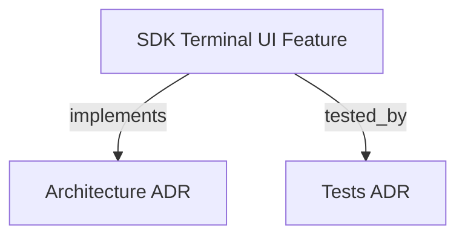

```graph
{"node_id":"feature:sdk_terminal_ui","domain":"terminal_ui","implements":["adr:architecture"],"tested_by":["adr:tests"],"entrypoints":["src/ui/TerminalProgress.ts"],"registration_files":[],"reference_files":["src/ui/AnsiHelpers.ts"],"code_files":["src/ui/StartupBanner.ts"],"test_files":["src/ui/__tests__/StartupBanner.test.ts","tests/unit/t26-terminal-progress.test.ts"],"knowledge":{"schema_version":1,"entities":[{"id":"capability:terminal-progress-rendering","type":"capability","label":"Terminal progress rendering","definition":"Render orchestration progress and animated status in the terminal.","aliases":[]}],"claims":[{"id":"claim:spinner-stream-and-cleanup","subject":"capability:terminal-progress-rendering","relation":null,"object":null,"statement":"TerminalProgress writes spinner frames to stderr, stops an existing spinner before starting another, and stopSpinner clears its interval and restores the cursor.","kind":"observation","status":"supported","evidence":[{"kind":"code","source":"src/ui/TerminalProgress.ts","locator":"startSpinner and stopSpinner","snapshot":null}],"derived_from":[],"gap":null}]}}
```

# SDK TERMINAL UI
Provides ANSI-based terminal rendering utilities for the CLI orchestrator.

## OVERVIEW
The terminal UI module handles visual representation in the CLI, including startup banners, animated spinners, and progress bars. It leverages ANSI escape sequences to provide a rich CLI experience.

## TOKEN REPORT
The shared token report renders usage by skill and cumulative totals for input, output, and cache reads. Counts of one million or more use two decimal places and the `M` suffix, for example `1,40M`; smaller counts are shown exactly. Model names are grouped by family without versions. It displays estimated cache savings and omits invocation cost. When input accounting is known for all nonempty records, it also shows the percentage of input served from cache, weighted by input tokens. Currently supported runners are Codex CLI, Claude CLI, and Claude SDK; unsupported runners (including Gemini) or invalid data suppress the percentage. `hrns report` uses the same renderer.

## FOLDER STRUCTURE
<folder_structure>
```
sdk/src/ui/
├── StartupBanner.ts      # ASCII welcome banner
├── AnsiHelpers.ts        # Low-level ANSI escape sequences
└── TerminalProgress.ts   # Animated spinner and progress bar
```
</folder_structure>

## HOW TO USE ANSI HELPERS

### Prerequisites
1. Execute within a terminal environment that supports ANSI escape codes.

### Steps
1. Import `AnsiHelpers` statically.
2. Use helper methods to output styled text.

<code_example>
# CORRECT: using AnsiHelpers for styling
console.log(AnsiHelpers.blue("Information"));

# WRONG: using raw escape characters
console.log("\x1b[34mInformation\x1b[0m");
</code_example>

## BEST PRACTICES
REQUIRED: Always call `stopSpinner()` in a `finally` block to prevent terminal corruption.
REQUIRED: Check `process.stdout.columns` before rendering width-dependent components.
REQUIRED: Import `AnsiHelpers` statically — do not use `require()` inline.
PROHIBITED: Writing raw ANSI escape strings outside of `AnsiHelpers`.
PROHIBITED: Calling `startSpinner()` again without calling `stopSpinner()` first.

## DOCUMENT MAP



## REFERENCES
- [**ARCHITECTURE.md**](../../adr/ARCHITECTURE.md): Folder structure and module responsibilities.
- [**SDK_CORE.md**](../orchestration/SDK_CORE.md): Orchestrator integration points.
- [**SDK_STEERING.md**](../orchestration/SDK_STEERING.md): Steering output confirmation UI dependencies.
